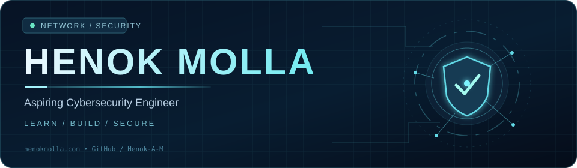
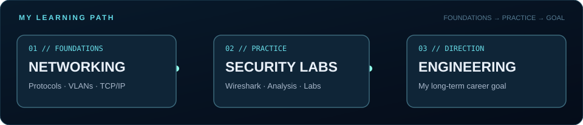

<!--
  Henok Molla's GitHub profile README
  Custom graphics and animations live in the assets/ directory.
  The portrait uses a clean transparent image without an SVG mask.
-->

<div align="center">

<a href="https://henokmolla.com">
<picture>
  <source media="(max-width: 600px)" srcset="https://raw.githubusercontent.com/Henok-A-M/Henok-A-M/main/assets/cyber-hero-mobile.svg" />
  
</picture>
</a>

<br />

</div>

<!-- PROFILE INTRO: Right-aligned high-resolution portrait with short, naturally wrapping text.
     On small screens, the animated headline and links sit BELOW the photo instead of being squeezed beside it. -->


### Hey, I'm Henok 👋

**Network Security Student**

Year Up United

City University of Seattle

*Aspiring Cybersecurity Engineer*

<br clear="all" />

<div align="center">

<picture>
  <source media="(max-width: 600px)" srcset="https://readme-typing-svg.demolab.com?font=Fira+Code&amp;weight=600&amp;size=19&amp;duration=3200&amp;pause=1000&amp;color=62D9E6&amp;center=true&amp;vCenter=true&amp;repeat=true&amp;width=360&amp;height=56&amp;lines=Network+Security;Cybersecurity+Engineering;Hands-on+Labs;Always+Learning" />
  
</picture>

**Learning, building, and securing networks — one project at a time.**

[](https://henokmolla.com)
[](https://www.linkedin.com/in/henok-molla)
[](https://henokmolla.com/#projects)


</div>

---

## 👋 About Me

I'm a **Year Up United Network Security** participant and a student at **City University of Seattle**, building hands-on skills in networking and cybersecurity.

My goal is to become a **cybersecurity or network security engineer**. I enjoy understanding how networks communicate, investigating traffic, and learning how to protect systems through practical labs and hands-on projects.

```text
henok@security-lab:~$ whoami
Henok Molla

henok@security-lab:~$ focus
Networking
Traffic analysis
Network security

henok@security-lab:~$ mindset
Learn. Build. Improve.
```

<div align="center">

<picture>
  <source media="(max-width: 600px)" srcset="https://raw.githubusercontent.com/Henok-A-M/Henok-A-M/main/assets/learning-path-mobile.svg" />
  
</picture>

</div>

## 🛠️ Tools & Skills I'm Building

<div align="center">


<br /><br />


</div>

## 📂 Featured Hands-On Work

**🧩 [VLAN Network Segmentation](https://henokmolla.com/#projects)**

Configured VLANs and tested network isolation in Cisco Packet Tracer.

**🔎 [Wireshark Traffic Analysis](https://henokmolla.com/#projects)**

Examined TCP handshakes, packet flags, and network traffic behavior.

**🖥️ [My Home Lab](https://henokmolla.com/#projects)**

In development: documenting my personal networking and security lab.

<details>
<summary><strong>🔐 Explore my future cybersecurity project ideas</strong></summary>

<br />

These projects are **planned**, not completed:

- Windows Security Log Monitoring
- Network Traffic Analysis with Wireshark
- User Access Management in Microsoft Entra ID
- Vulnerability Scanning with Nessus
- SIEM Monitoring with Microsoft Sentinel
- Phishing Email Investigation
- IP Reputation Analysis with VirusTotal
- Linux System Hardening
- Incident Response Playbook
- Firewall Configuration

[Visit the interactive project gallery](https://henokmolla.com/#projects)

</details>

## 📊 GitHub Activity

<div align="center">


<br />


</div>

## 🎯 Current Focus

- Grow my understanding of **network protocols, traffic analysis, and segmentation**
- Build practical skills in **security operations, troubleshooting, and system defense**
- Document my learning with labs, notes, and projects
- Prepare for opportunities in **cybersecurity and network engineering**

---

<div align="center">

<picture>
  <source media="(max-width: 600px)" srcset="https://raw.githubusercontent.com/Henok-A-M/Henok-A-M/main/assets/cyber-footer-mobile.svg" />
  
</picture>

### 🤝 Let's Connect

[🌐 Portfolio](https://henokmolla.com) · [💼 LinkedIn](https://www.linkedin.com/in/henok-molla) · [💻 Projects](https://henokmolla.com/#projects)

</div>
